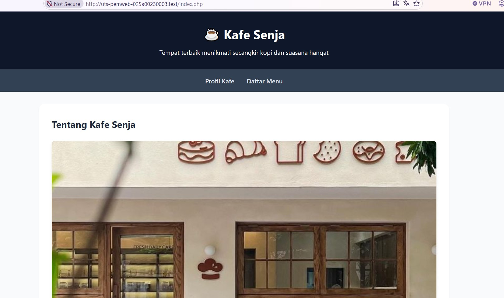
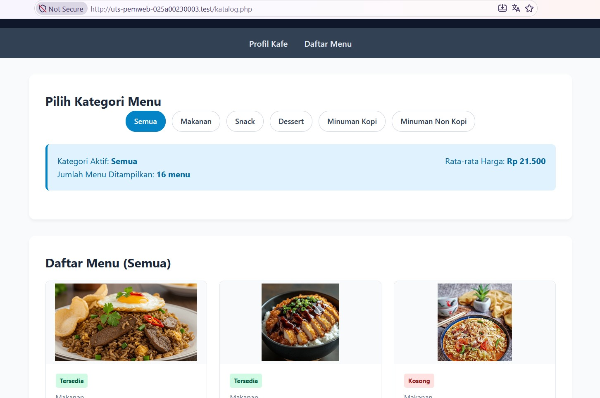
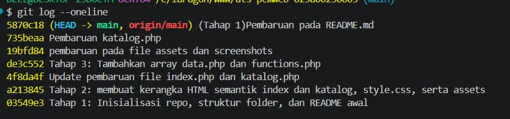

# README - Kopi & Senja Kafe

## 1. Identitas

- **Nama:** Sabilla Istiqomah
- **NIM:** 025A00230003
- **Kelas:** [Isi kelas]
- **Program Studi:** Informatika
- **Mata Kuliah:** Pemrograman Web

## 2. Deskripsi Project

Kopi & Senja Kafe merupakan website sederhana berbasis PHP yang menampilkan informasi dan katalog menu kafe. Project ini dibuat untuk menerapkan dasar pemrograman PHP, pengelolaan data menu, serta penggunaan fungsi untuk membantu menampilkan dan mengolah data.

Website ini menyajikan profil resmi kafe serta katalog menu yang dikelompokkan ke dalam lima kategori, yaitu Makanan, Snack, Dessert, Minuman Kopi, dan Minuman Non Kopi. Selain itu, website dilengkapi dengan fitur filter interaktif berdasarkan kategori serta perhitungan statistik ringkasan harga secara dinamis.

## 3. Cara Menjalankan Project di Localhost

Berikut langkah-langkah untuk menjalankan project Kopi & Senja Kafe:

1. Pastikan server lokal, seperti Laragon atau XAMPP, sudah terinstal dan aktif.
2. Letakkan folder project ke dalam direktori root server:
   - Laragon: `C:\laragon\www\`
   - XAMPP: `C:\xampp\htdocs\`
3. Buka browser.
4. Masukkan URL berikut pada address bar:

   ```text
   http://localhost/uts-pemweb-025a00230003/index.php
   ```

5. Tekan Enter untuk membuka halaman utama website Kopi & Senja Kafe.

## 4. Daftar Fitur, File, dan Fungsi yang Digunakan

### 4.1 Halaman Profil dan Navigasi Antarhalaman

- **File:** `index.php`, `style.css`
- **Fungsi:** Menampilkan informasi profil kafe, jam operasional, lokasi, serta menu navigasi antarhalaman.
- **Implementasi:** Menggunakan elemen HTML5 semantik seperti `<header>`, `<nav>`, `<main>`, `<section>`, dan `<footer>` untuk menyusun struktur halaman website.

### 4.2 Katalog Menu Interaktif dan Filter Kategori

- **File:** `katalog.php`
- **Fungsi:** Menampilkan daftar menu berdasarkan kategori yang dipilih pengguna.
- **Implementasi:** Mengambil kategori yang dipilih melalui `$_GET['kategori']`, menyaring data menu, menggunakan perulangan `foreach`, serta menampilkan kartu menu secara dinamis.

### 4.3 Ringkasan Hasil Perhitungan

- **File:** `functions.php`, `katalog.php`
- **Fungsi:** Menghitung jumlah menu yang ditampilkan dan rata-rata harga menu.
- **Implementasi:** Menggunakan fungsi buatan `formatRupiah()` untuk memformat harga ke dalam bentuk rupiah dan `hitungRataHarga()` untuk menghitung rata-rata harga menu.

### 4.4 Keamanan Output Data

- **File:** `functions.php`
- **Fungsi:** Membantu menjaga keamanan data yang ditampilkan pada halaman website.
- **Implementasi:** Menggunakan fungsi pembungkus `e()` yang menerapkan fungsi bawaan PHP `htmlspecialchars()` untuk membantu mencegah serangan Cross-Site Scripting (XSS).

## 5. Daftar Fungsi Array Bawaan PHP dan Kegunaannya

Berikut fungsi array bawaan PHP yang digunakan dalam project Kopi & Senja Kafe:

| No. | Fungsi Array | Kegunaan |
|---|---|---|
| 1 | `count()` | Menghitung jumlah elemen dalam array, termasuk jumlah total menu yang tersedia atau sedang ditampilkan. |
| 2 | `array_filter()` | Menyaring daftar menu berdasarkan kategori yang dipilih oleh pengguna. |
| 3 | `array_column()` | Mengambil nilai dari kolom tertentu, seperti kolom harga pada array multidimensi. |
| 4 | `array_sum()` | Menjumlahkan seluruh nilai harga menu untuk membantu menghitung rata-rata harga. |
| 5 | `array_values()` | Menyusun ulang indeks array agar dimulai kembali dari indeks numerik secara berurutan setelah proses penyaringan data. |

## 6. Tangkapan Layar

Berikut merupakan tangkapan layar hasil implementasi website Kopi & Senja Kafe.

### 6.1 Tampilan Halaman Profil



### 6.2 Tampilan Halaman Katalog Menu



### 6.3 Screenshots comiid


## 7. Sumber Referensi dan Catatan Penggunaan AI

### 7.1 Sumber Referensi

- Dokumentasi resmi PHP: https://www.php.net/docs.php
- Dokumentasi fungsi array PHP: https://www.php.net/manual/en/ref.array.php

### 7.2 Catatan Penggunaan AI

AI digunakan sebagai alat bantu untuk memahami konsep PHP, membantu memeriksa kesalahan kode hasil akhir project tetap diperiksa dan disesuaikan kembali oleh penulis.

